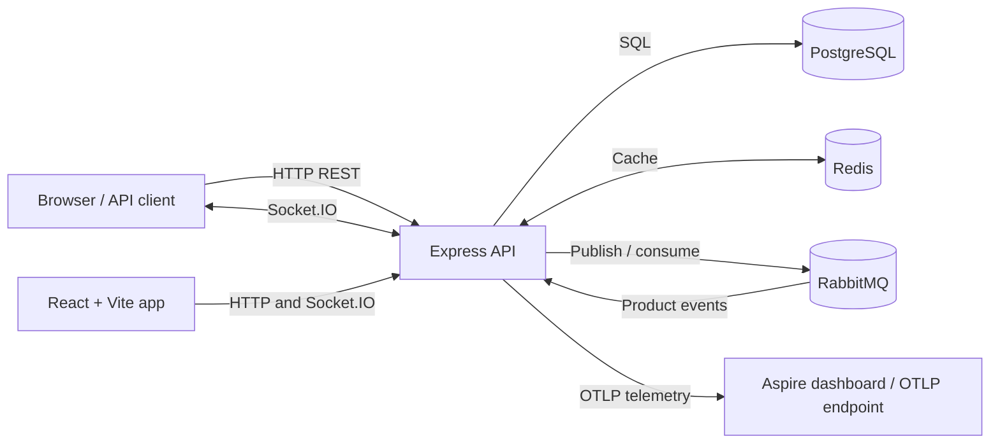
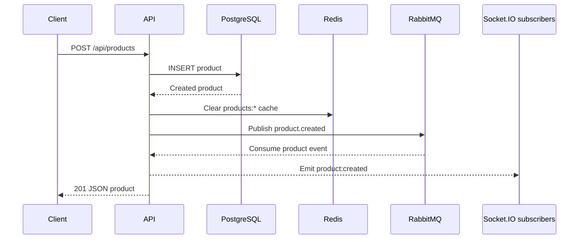

# Architecture

## System context

The web client and API are separate applications. PostgreSQL, Redis, and RabbitMQ are separate dependencies. Docker Compose and .NET Aspire provide alternative local orchestration definitions.

## Components

### Web app

The `web/` project is React 19 with Vite, TypeScript, and Tailwind CSS. The active HTML entry loads `src/main.tsx`, which renders the responsive Flowbite-inspired catalog dashboard. Its sidebar navigates to the overview, `/api/products`, and `/api/product-details` management screens. The API URL is configurable with `VITE_API_URL`.

### API

The `api/` project is a Node.js 20 TypeScript/Express 5 service. `src/index.ts` configures middleware, Swagger UI, service initialization, health and REST routes, Socket.IO, and graceful shutdown. Routes delegate database and cache work to `ProductService`.

- `GET /health` returns process health, timestamp, and uptime.
- `/api/products` exposes product CRUD operations.
- `/api/product-details` exposes product detail lookup and CRUD operations.
- `/api-docs` serves the Swagger UI.

The service initializes PostgreSQL, Redis, and RabbitMQ before listening; startup fails if an initialization step fails.

### Persistence and cache

PostgreSQL owns the `products` and `product_details` tables. Product detail rows reference products and are deleted when a parent product is deleted. Redis caches product list/item and product-detail lookups with a 10-minute TTL. Product mutations clear product cache keys. Product-detail create/update clears product-detail keys; detail deletion currently does not clear that cache.

### Messaging and real-time events

Product create, update, and delete publish JSON messages to the RabbitMQ `product_events` topic exchange. The API consumes the product routing keys and relays them to clients in the Socket.IO `products` room. A client joins that room by emitting `subscribe_products`; the server responds with `subscribed` and emits `product:created`, `product:updated`, or `product:deleted` notifications.

RabbitMQ routing keys use dot notation (for example, `product.created`); Socket.IO event names use a colon (for example, `product:created`). Product-detail changes are not currently broadcast through this pipeline. The web client displays product events in a toolbar notification drawer and stores up to 100 entries in browser local storage. Product-detail activity is recorded locally in the browser only.

The product-detail screen fetches details for each product using `GET /api/product-details/product/:productId`. There is no endpoint for listing every detail row, so the UI displays the single record returned for each product; the database itself does not constrain a product to one detail row.

## Typical product-create flow

## Observability

The API initializes OpenTelemetry before application modules, enabling automatic instrumentation and OTLP exporters for traces, metrics, and logs. Pino provides structured logging. Custom metric calls currently cover API activity and Socket.IO connections; helper definitions for several other metric categories do not imply those metrics are actively recorded. When running under Aspire, the AppHost injects the OTLP settings and exposes a dashboard URL reported at runtime. Compose does not start an OTLP collector or dashboard.

## Repository map

- `api/src/config/` — environment and connection-string parsing
- `api/src/database/` — PostgreSQL, Redis, and RabbitMQ setup
- `api/src/routes/` — REST route handlers
- `api/src/services/` — product business operations
- `api/src/telemetry/` — OpenTelemetry, metrics, tracing, and logging
- `api/src/websocket/` — Socket.IO server and event relay
- `web/src/` — React application and API client
- `docker/docker-compose.yml` — container orchestration
- `aspire/Program.cs` — .NET Aspire AppHost

For startup commands and dependencies, see [Getting started](GETTING_STARTED.md). Endpoint examples are in [API_EXAMPLES.md](API_EXAMPLES.md).
